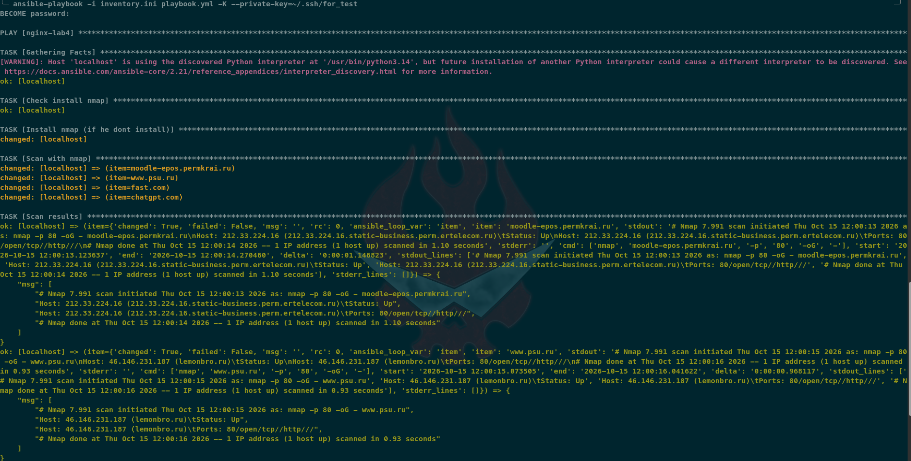
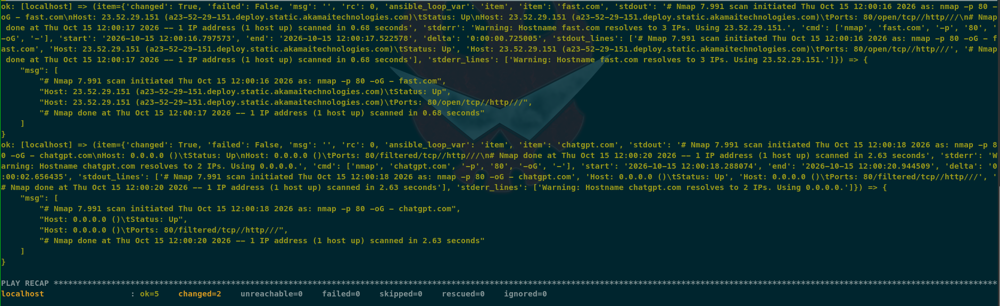

Я Климов Сергей Сергеевич, ИТ-14.
Все файлы работы лежат в репозитории.
Здесь я описал результаты выполнения лабораторной работы 5 по предмету "Devops и администрирование (Методы и инструменты DevOps)".





в виде текста (есть отдельный файл log.txt с этим же выводом):
```bash
╰─ ansible-playbook -i inventory.ini playbook.yml -K --private-key=~/.ssh/for_test                                                                                                                           ─╯
BECOME password:

PLAY [nginx-lab4] **********************************************************************************************************************************************************************************************

TASK [Gathering Facts] *****************************************************************************************************************************************************************************************
[WARNING]: Host 'localhost' is using the discovered Python interpreter at '/usr/bin/python3.14', but future installation of another Python interpreter could cause a different interpreter to be discovered. See https://docs.ansible.com/ansible-core/2.21/reference_appendices/interpreter_discovery.html for more information.
ok: [localhost]

TASK [Check install nmap] **************************************************************************************************************************************************************************************
ok: [localhost]

TASK [Install nmap (if he dont install)] ***********************************************************************************************************************************************************************
changed: [localhost]

TASK [Scan with nmap] ******************************************************************************************************************************************************************************************
changed: [localhost] => (item=moodle-epos.permkrai.ru)
changed: [localhost] => (item=www.psu.ru)
changed: [localhost] => (item=fast.com)
changed: [localhost] => (item=chatgpt.com)

TASK [Scan results] ********************************************************************************************************************************************************************************************
ok: [localhost] => (item={'changed': True, 'failed': False, 'msg': '', 'rc': 0, 'ansible_loop_var': 'item', 'item': 'moodle-epos.permkrai.ru', 'stdout': '# Nmap 7.991 scan initiated Thu Oct 15 12:00:13 2026 as: nmap -p 80 -oG - moodle-epos.permkrai.ru\nHost: 212.33.224.16 (212.33.224.16.static-business.perm.ertelecom.ru)\tStatus: Up\nHost: 212.33.224.16 (212.33.224.16.static-business.perm.ertelecom.ru)\tPorts: 80/open/tcp//http///\n# Nmap done at Thu Oct 15 12:00:14 2026 -- 1 IP address (1 host up) scanned in 1.10 seconds', 'stderr': '', 'cmd': ['nmap', 'moodle-epos.permkrai.ru', '-p', '80', '-oG', '-'], 'start': '2026-10-15 12:00:13.123637', 'end': '2026-10-15 12:00:14.270460', 'delta': '0:00:01.146823', 'stdout_lines': ['# Nmap 7.991 scan initiated Thu Oct 15 12:00:13 2026 as: nmap -p 80 -oG - moodle-epos.permkrai.ru', 'Host: 212.33.224.16 (212.33.224.16.static-business.perm.ertelecom.ru)\tStatus: Up', 'Host: 212.33.224.16 (212.33.224.16.static-business.perm.ertelecom.ru)\tPorts: 80/open/tcp//http///', '# Nmap done at Thu Oct 15 12:00:14 2026 -- 1 IP address (1 host up) scanned in 1.10 seconds'], 'stderr_lines': []}) => {
    "msg": [
        "# Nmap 7.991 scan initiated Thu Oct 15 12:00:13 2026 as: nmap -p 80 -oG - moodle-epos.permkrai.ru",
        "Host: 212.33.224.16 (212.33.224.16.static-business.perm.ertelecom.ru)\tStatus: Up",
        "Host: 212.33.224.16 (212.33.224.16.static-business.perm.ertelecom.ru)\tPorts: 80/open/tcp//http///",
        "# Nmap done at Thu Oct 15 12:00:14 2026 -- 1 IP address (1 host up) scanned in 1.10 seconds"
    ]
}
ok: [localhost] => (item={'changed': True, 'failed': False, 'msg': '', 'rc': 0, 'ansible_loop_var': 'item', 'item': 'www.psu.ru', 'stdout': '# Nmap 7.991 scan initiated Thu Oct 15 12:00:15 2026 as: nmap -p 80 -oG - www.psu.ru\nHost: 46.146.231.187 (lemonbro.ru)\tStatus: Up\nHost: 46.146.231.187 (lemonbro.ru)\tPorts: 80/open/tcp//http///\n# Nmap done at Thu Oct 15 12:00:16 2026 -- 1 IP address (1 host up) scanned in 0.93 seconds', 'stderr': '', 'cmd': ['nmap', 'www.psu.ru', '-p', '80', '-oG', '-'], 'start': '2026-10-15 12:00:15.073505', 'end': '2026-10-15 12:00:16.041622', 'delta': '0:00:00.968117', 'stdout_lines': ['# Nmap 7.991 scan initiated Thu Oct 15 12:00:15 2026 as: nmap -p 80 -oG - www.psu.ru', 'Host: 46.146.231.187 (lemonbro.ru)\tStatus: Up', 'Host: 46.146.231.187 (lemonbro.ru)\tPorts: 80/open/tcp//http///', '# Nmap done at Thu Oct 15 12:00:16 2026 -- 1 IP address (1 host up) scanned in 0.93 seconds'], 'stderr_lines': []}) => {
    "msg": [
        "# Nmap 7.991 scan initiated Thu Oct 15 12:00:15 2026 as: nmap -p 80 -oG - www.psu.ru",
        "Host: 46.146.231.187 (lemonbro.ru)\tStatus: Up",
        "Host: 46.146.231.187 (lemonbro.ru)\tPorts: 80/open/tcp//http///",
        "# Nmap done at Thu Oct 15 12:00:16 2026 -- 1 IP address (1 host up) scanned in 0.93 seconds"
    ]
}
ok: [localhost] => (item={'changed': True, 'failed': False, 'msg': '', 'rc': 0, 'ansible_loop_var': 'item', 'item': 'fast.com', 'stdout': '# Nmap 7.991 scan initiated Thu Oct 15 12:00:16 2026 as: nmap -p 80 -oG - fast.com\nHost: 23.52.29.151 (a23-52-29-151.deploy.static.akamaitechnologies.com)\tStatus: Up\nHost: 23.52.29.151 (a23-52-29-151.deploy.static.akamaitechnologies.com)\tPorts: 80/open/tcp//http///\n# Nmap done at Thu Oct 15 12:00:17 2026 -- 1 IP address (1 host up) scanned in 0.68 seconds', 'stderr': 'Warning: Hostname fast.com resolves to 3 IPs. Using 23.52.29.151.', 'cmd': ['nmap', 'fast.com', '-p', '80', '-oG', '-'], 'start': '2026-10-15 12:00:16.797573', 'end': '2026-10-15 12:00:17.522578', 'delta': '0:00:00.725005', 'stdout_lines': ['# Nmap 7.991 scan initiated Thu Oct 15 12:00:16 2026 as: nmap -p 80 -oG - fast.com', 'Host: 23.52.29.151 (a23-52-29-151.deploy.static.akamaitechnologies.com)\tStatus: Up', 'Host: 23.52.29.151 (a23-52-29-151.deploy.static.akamaitechnologies.com)\tPorts: 80/open/tcp//http///', '# Nmap done at Thu Oct 15 12:00:17 2026 -- 1 IP address (1 host up) scanned in 0.68 seconds'], 'stderr_lines': ['Warning: Hostname fast.com resolves to 3 IPs. Using 23.52.29.151.']}) => {
    "msg": [
        "# Nmap 7.991 scan initiated Thu Oct 15 12:00:16 2026 as: nmap -p 80 -oG - fast.com",
        "Host: 23.52.29.151 (a23-52-29-151.deploy.static.akamaitechnologies.com)\tStatus: Up",
        "Host: 23.52.29.151 (a23-52-29-151.deploy.static.akamaitechnologies.com)\tPorts: 80/open/tcp//http///",
        "# Nmap done at Thu Oct 15 12:00:17 2026 -- 1 IP address (1 host up) scanned in 0.68 seconds"
    ]
}
ok: [localhost] => (item={'changed': True, 'failed': False, 'msg': '', 'rc': 0, 'ansible_loop_var': 'item', 'item': 'chatgpt.com', 'stdout': '# Nmap 7.991 scan initiated Thu Oct 15 12:00:18 2026 as: nmap -p 80 -oG - chatgpt.com\nHost: 0.0.0.0 ()\tStatus: Up\nHost: 0.0.0.0 ()\tPorts: 80/filtered/tcp//http///\n# Nmap done at Thu Oct 15 12:00:20 2026 -- 1 IP address (1 host up) scanned in 2.63 seconds', 'stderr': 'Warning: Hostname chatgpt.com resolves to 2 IPs. Using 0.0.0.0.', 'cmd': ['nmap', 'chatgpt.com', '-p', '80', '-oG', '-'], 'start': '2026-10-15 12:00:18.288074', 'end': '2026-10-15 12:00:20.944509', 'delta': '0:00:02.656435', 'stdout_lines': ['# Nmap 7.991 scan initiated Thu Oct 15 12:00:18 2026 as: nmap -p 80 -oG - chatgpt.com', 'Host: 0.0.0.0 ()\tStatus: Up', 'Host: 0.0.0.0 ()\tPorts: 80/filtered/tcp//http///', '# Nmap done at Thu Oct 15 12:00:20 2026 -- 1 IP address (1 host up) scanned in 2.63 seconds'], 'stderr_lines': ['Warning: Hostname chatgpt.com resolves to 2 IPs. Using 0.0.0.0.']}) => {
    "msg": [
        "# Nmap 7.991 scan initiated Thu Oct 15 12:00:18 2026 as: nmap -p 80 -oG - chatgpt.com",
        "Host: 0.0.0.0 ()\tStatus: Up",
        "Host: 0.0.0.0 ()\tPorts: 80/filtered/tcp//http///",
        "# Nmap done at Thu Oct 15 12:00:20 2026 -- 1 IP address (1 host up) scanned in 2.63 seconds"
    ]
}

PLAY RECAP *****************************************************************************************************************************************************************************************************
localhost                  : ok=5    changed=2    unreachable=0    failed=0    skipped=0    rescued=0    ignored=0


```
